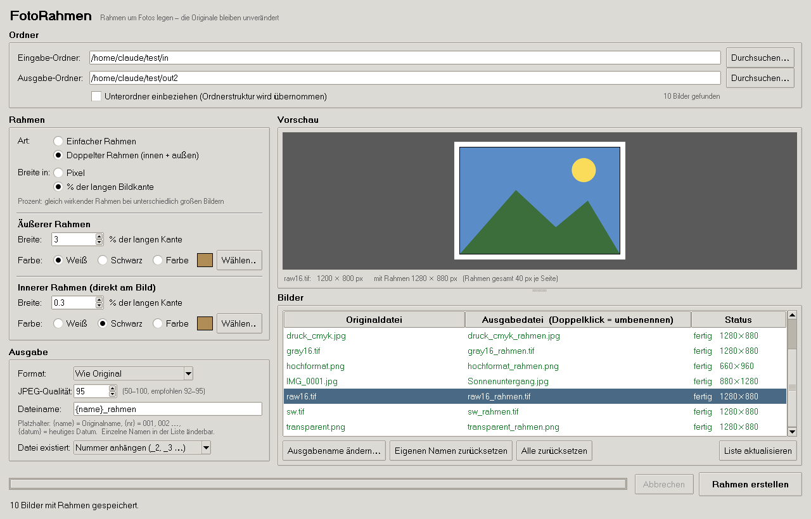

# FotoRahmen

Legt Fotos stapelweise einen Rahmen um – als eigenständige App für **Windows (eine .exe)** und **macOS (.app)**.
Die Originale im Eingabe-Ordner werden nur gelesen und **nie verändert**; alle Ergebnisse landen im Ausgabe-Ordner.

## Funktionen

- **Einfacher Rahmen** oder **doppelter Rahmen** (schmaler innerer + breiter äußerer Rahmen, z. B. schwarze Linie + weißer Rand)
- Farben: **Weiß**, **Schwarz** oder **beliebige Farbe** (Farbwähler)
- Breite in **Pixeln** oder in **% der langen Bildkante** (gleich wirkender Rahmen bei unterschiedlich großen Bildern)
- **Live-Vorschau** mit Rahmen, inkl. Anzeige der neuen Bildgröße
- **Stapelverarbeitung** aller Bilder eines Ordners, optional mit Unterordnern (Struktur wird übernommen), Fortschrittsanzeige, Abbrechen jederzeit
- **Ausgabenamen** per Vorlage (`{name}`, `{nr}`, `{datum}`) – und jede Datei einzeln umbenennbar (Doppelklick oder F2 in der Liste)
- Vorhandene Dateien: Nummer anhängen, überschreiben oder überspringen
- Einstellungen werden beim Beenden gespeichert

### Unterstützte Formate

| Format | Lesen | Hinweise |
|---|---|---|
| JPEG (.jpg/.jpeg) | ✔ | EXIF, Farbprofil (ICC) und DPI bleiben erhalten; Hochformat-Drehung wird korrekt berücksichtigt; CMYK bleibt CMYK |
| TIFF (.tif/.tiff) | ✔ | **8 und 16 Bit** – 16-Bit-TIFFs bleiben verlustfrei 16 Bit (inkl. Farbprofil und Auflösung); Graustufen, RGB, CMYK |
| PNG | ✔ | inkl. Transparenz und 16-Bit-Graustufen |
| GIF | ✔ | animierte GIFs werden Bild für Bild gerahmt |
| HEIC/HEIF | ✔ | iPhone-Fotos |
| WebP, BMP, JPEG 2000 | ✔ | |

Ausgabeformat: **wie Original**, oder umwandeln in JPEG, PNG oder TIFF. JPEG-Qualität einstellbar.
RAW-Dateien (CR3, NEF, ARW …) werden nicht unterstützt – bitte vorher als TIFF oder JPEG exportieren.

## Fertige App bekommen

### Variante A – automatisch über GitHub (empfohlen)
1. Diesen Ordner in ein GitHub-Repository hochladen (auch privat möglich).
2. Unter **Actions** startet „FotoRahmen bauen“ automatisch (oder manuell über *Run workflow*).
3. Nach ca. 5–10 Minuten liegen unter dem Lauf bei **Artifacts**:
   - `FotoRahmen-Windows` → `FotoRahmen.exe`
   - `FotoRahmen-macOS-AppleSilicon` → für Macs mit M1/M2/M3/M4
   - `FotoRahmen-macOS-Intel` → für ältere Intel-Macs
4. Optional: einen Tag wie `v1.0` pushen – dann entsteht ein Release mit allen Dateien zum Download.

### Variante B – selbst bauen
Python 3.12 oder neuer von [python.org](https://www.python.org/downloads/) installieren, dann:

- **Windows:** `build_windows.bat` doppelklicken → `dist\FotoRahmen.exe`
- **macOS:** im Terminal `./build_macos.sh` → `dist/FotoRahmen.app`

Der Build führt vorher automatisch einen Selbsttest aller Formate durch (`python selftest.py`).

## Erster Start – Sicherheitshinweise

Die App ist nicht kostenpflichtig bei Microsoft/Apple signiert, deshalb warnt das System beim ersten Start:

- **Windows (SmartScreen):** „Weitere Informationen“ → „Trotzdem ausführen“.
- **macOS:** App in den Programme-Ordner ziehen, dann **Rechtsklick → Öffnen → Öffnen**.
  Falls macOS meldet, die App sei „beschädigt“ (passiert bei Downloads aus dem Internet), einmalig im Terminal:
  `xattr -cr /Applications/FotoRahmen.app`
  Alternativ: Systemeinstellungen → Datenschutz & Sicherheit → „Dennoch öffnen“.

Die Windows-EXE ist eine einzelne Datei; beim Start entpackt sie sich kurz im Hintergrund (1–3 Sekunden).

## Bedienung

1. **Eingabe-Ordner** wählen – alle Bilder darin erscheinen in der Liste (Ausgabe-Ordner wird mit „…/mit Rahmen“ vorgeschlagen).
2. **Rahmen** einstellen: Art, Einheit, Breite und Farbe. Die Vorschau aktualisiert sich sofort; ein Klick auf ein Bild in der Liste zeigt dieses Bild.
3. **Ausgabe**: Format, Dateinamen-Vorlage. Einzelne Namen per **Doppelklick** in der Spalte „Ausgabedatei“ ändern (Enter = übernehmen, Esc = abbrechen). Eigene Namen werden blau angezeigt.
4. **Rahmen erstellen** klicken. Am Ende kann der Ausgabe-Ordner direkt geöffnet werden.

Tipp für einen klassischen Galerie-Look: Doppelter Rahmen, % der langen Kante, innen 0,2 % Schwarz, außen 4 % Weiß.

## Dateien

| Datei | Inhalt |
|---|---|
| `fotorahmen.py` | Programm mit Oberfläche (Start: `python fotorahmen.py`) |
| `rahmen_core.py` | Bildverarbeitung |
| `selftest.py` | Selbsttest aller Formate |
| `build_windows.bat`, `build_macos.sh` | Build-Skripte |
| `.github/workflows/build.yml` | Automatischer Build für Windows + macOS |
| `assets/` | App-Icon |
