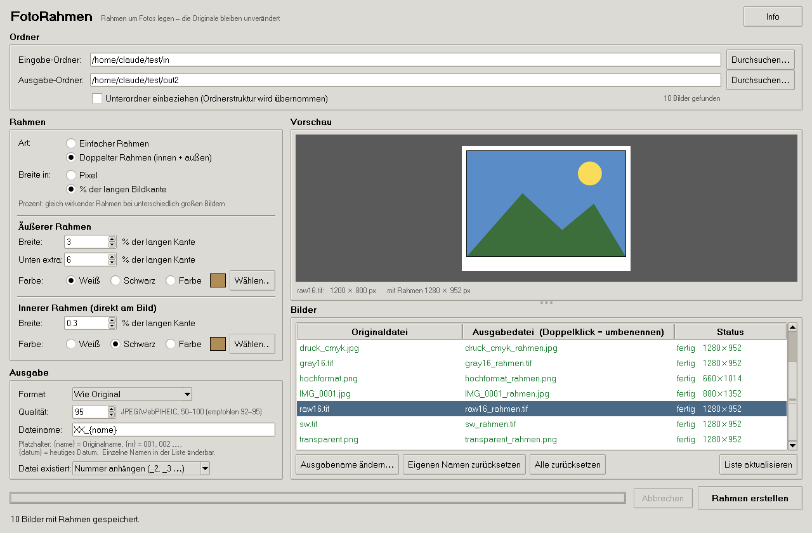

# FotoRahmen 1.1

Legt Fotos stapelweise einen Rahmen um – als eigenständige App für **Windows (eine einzige .exe)** und **macOS (.app)**.
Die Originale im Eingabe-Ordner werden nur gelesen und **nie verändert**; alle Ergebnisse landen im Ausgabe-Ordner.

> © 2026 **Stefan J. Kaiser** · Idee und Prompt: Stefan J. Kaiser · Umsetzung: Claude Opus 5.5 (Anthropic), 3. November 2026
> Lizenz: [MIT](LICENSE) – der Quellcode ist öffentlich.

## Funktionen

- **Einfacher Rahmen** oder **doppelter Rahmen** (schmaler innerer + breiter äußerer Rahmen, z. B. schwarze Linie + weißer Rand)
- Farben: **Weiß**, **Schwarz** oder **beliebige Farbe** (Farbwähler)
- Breite in **Pixeln** oder in **% der langen Bildkante** (gleich wirkender Rahmen bei unterschiedlich großen Bildern)
- **Unten extra**: breiterer unterer Rand (Galerie-Look, Platz für Signatur)
- **Live-Vorschau** mit Rahmen und Anzeige der neuen Bildgröße
- **Stapelverarbeitung** aller Bilder eines Ordners, optional mit Unterordnern (Struktur wird übernommen), Fortschrittsanzeige, jederzeit abbrechbar
- **Ausgabenamen** per Vorlage (`{name}`, `{nr}`, `{datum}`) – jede Datei zusätzlich einzeln umbenennbar (Doppelklick oder F2 in der Liste)
- Vorhandene Dateien: Nummer anhängen, überschreiben oder überspringen
- Einstellungen werden beim Beenden gespeichert

### Unterstützte Formate

| Format | Hinweise |
|---|---|
| JPEG (.jpg/.jpeg) | EXIF, Farbprofil (ICC) und DPI bleiben erhalten; Hochformat-Drehung wird berücksichtigt; CMYK bleibt CMYK (Schwarz = reines K) |
| TIFF (.tif/.tiff) | **8 und 16 Bit** – 16-Bit-TIFFs bleiben verlustfrei 16 Bit (inkl. Farbprofil und Auflösung); Graustufen, RGB, RGBA, CMYK; bei mehrseitigen TIFFs wird Seite 1 verwendet |
| PNG | inkl. Transparenz und 16-Bit-Graustufen |
| GIF, WebP | auch **animiert** (Bild für Bild gerahmt) |
| HEIC/HEIF | iPhone-Fotos |
| BMP, JPEG 2000 | |

Ausgabeformat: **wie Original** oder umwandeln in JPEG, PNG oder TIFF. Qualität (JPEG/WebP/HEIC) einstellbar.
RAW-Dateien (CR3, NEF, ARW …) werden nicht unterstützt – bitte vorher als TIFF oder JPEG exportieren.

## Installation

### Fertige Programme
Unter **Releases** bzw. im letzten Lauf unter **Actions → Artifacts**:

| Datei | für |
|---|---|
| `FotoRahmen-Windows.exe` | Windows 10/11 (64 Bit) – einfach starten, keine Installation nötig |
| `FotoRahmen-macOS-AppleSilicon.zip` | Macs mit M1/M2/M3/M4 |
| `FotoRahmen-macOS-Intel.zip` | Macs mit Intel-Prozessor |

**Erster Start – Sicherheitshinweise.** Die Programme sind nicht kostenpflichtig bei Microsoft/Apple signiert, deshalb warnt das System einmalig:

- **Windows (SmartScreen):** „Weitere Informationen“ → „Trotzdem ausführen“. Die EXE entpackt sich beim Start kurz im Hintergrund (1–3 Sekunden).
- **macOS:** ZIP entpacken, `FotoRahmen.app` in den Programme-Ordner ziehen, dann **Rechtsklick → Öffnen → Öffnen**.
  Meldet macOS, die App sei „beschädigt“ oder „kann nicht überprüft werden“: Systemeinstellungen → Datenschutz & Sicherheit → „Dennoch öffnen“ – oder einmalig im Terminal:
  `xattr -cr /Applications/FotoRahmen.app`

### Selbst bauen
Siehe [docs/ENTWICKLER.md](docs/ENTWICKLER.md#bauen). Kurz: Python 3.12 installieren, dann `build_windows.bat` (Windows) bzw. `./build_macos.sh` (macOS).

## Bedienung

1. **Eingabe-Ordner** wählen – alle Bilder darin erscheinen in der Liste (als Ausgabe-Ordner wird „…/mit Rahmen“ vorgeschlagen).
2. **Rahmen** einstellen: Art, Einheit, Breite, ggf. „Unten extra“ und Farbe. Die Vorschau aktualisiert sich sofort; ein Klick auf ein Bild in der Liste zeigt dieses Bild.
3. **Ausgabe**: Format, Qualität, Dateinamen-Vorlage. Einzelne Namen per **Doppelklick** in der Spalte „Ausgabedatei“ ändern (Enter = übernehmen, Esc = abbrechen). Eigene Namen werden blau angezeigt.
4. **Rahmen erstellen** (oder Strg+Enter / ⌘+Enter). Am Ende kann der Ausgabe-Ordner direkt geöffnet werden.

**Rezepte**
- *Galerie-Look:* Doppelter Rahmen, % der langen Kante, innen 0,2 % Schwarz, außen 4 % Weiß, unten extra 2 %.
- *Social Media:* Einfacher Rahmen, 3 % Weiß, Format JPEG, Qualität 92.
- *Druck (16 Bit):* TIFF wie Original, Pixelangaben passend zur Druckauflösung (z. B. 5 mm bei 300 dpi ≈ 59 px).

## Dokumentation

| Datei | Inhalt |
|---|---|
| [docs/ENTWICKLER.md](docs/ENTWICKLER.md) | Aufbau, Code-Referenz, Änderungen vornehmen, Bauen, Testen |
| [CHANGELOG.md](CHANGELOG.md) | Änderungen je Version |
| [PROMPT.md](PROMPT.md) | Ursprünglicher Prompt und verbesserter Prompt |
| [LICENSE](LICENSE) | MIT-Lizenz |
