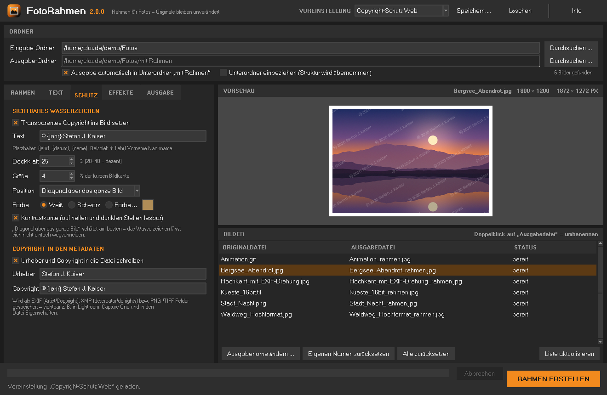

# FotoRahmen 2.0

Legt Fotos stapelweise einen Rahmen und einen Copyright-Schutz an – als eigenständige App für **Windows (eine einzige .exe)**, **macOS (.app)** und **iPhone/iPad (iOS-App, siehe [ios/README.md](ios/README.md))**, im dunklen Design im Stil von Capture One.
Die Originale werden nur gelesen und **nie verändert**; alle Ergebnisse landen im Ausgabe-Ordner.

> © 2026 **Stefan J. Kaiser** · Idee und Prompt: Stefan J. Kaiser · Umsetzung: Claude Opus 5.5 (Anthropic), 3.–4. November 2026
> Lizenz: [GNU GPL v3](LICENSE) – der Quellcode ist öffentlich.

## Funktionen

**Rahmen**
- **Einfacher** oder **doppelter Rahmen** (schmaler innerer + breiter äußerer Rahmen)
- Farben: **Weiß**, **Schwarz** oder **beliebige Farbe**
- Breite in **Pixeln** oder in **% der langen Bildkante**
- **Unten extra**: breiterer unterer Rand (Galerie-Look)

**Text** – Textzeile/Signatur im unteren Rand mit Platzhaltern `{name}`, `{datum}`, `{jahr}`; Größe, Position (links/Mitte/rechts), Farbe, eingebaute oder eigene Schrift (.ttf/.otf)

**Schutz** – Copyright als **transparentes Wasserzeichen** ins Bild (Ecke, Mitte oder diagonal über das ganze Bild wiederholt; Deckkraft, Größe, Farbe, Kontrastkante) und **Urheber/Copyright in den Metadaten** (EXIF, XMP, PNG/TIFF) – lesbar in Lightroom, Capture One und den Datei-Eigenschaften

**Effekte** – abgerundete Ecken und weicher Schatten (bei Ausgabe als PNG oder WebP)

**Ausgabe**
- Format wie Original oder JPEG, PNG, TIFF, WebP; Qualität einstellbar
- **Lange Kante begrenzen** (z. B. 2048 px für Social Media) – gilt für das fertige Bild inkl. Rahmen
- Dateinamen per Vorlage (`{name}`, `{nr}`, `{datum}`), jede Datei zusätzlich einzeln umbenennbar
- Vorhandene Dateien: Nummer anhängen, überschreiben oder überspringen

**Bedienung**
- **Voreinstellungen** speichern, benennen, laden und löschen (6 mitgeliefert)
- Eigenes **Logo** (Orange → Schwarz) in Taskleiste, Task-Manager, Dock und Menüleiste
- **Drag & Drop**: Ordner oder einzelne Bilder ins Fenster ziehen
- **Live-Vorschau** mit Rahmen, Text, Effekten und der tatsächlichen Ausgabegröße
- **Stapelverarbeitung** mit Fortschritt, Status je Datei, Abbrechen; optional mit Unterordnern

### Unterstützte Formate

| Format | Hinweise |
|---|---|
| JPEG | EXIF, Farbprofil (ICC) und DPI bleiben erhalten; Hochformat-Drehung wird berücksichtigt; CMYK bleibt CMYK (Schwarz = reines K) |
| TIFF | **8 und 16 Bit** – 16-Bit-TIFFs bleiben verlustfrei 16 Bit (auch mit Text und Größenbegrenzung); Graustufen, RGB, RGBA, CMYK; mehrseitige TIFFs: Seite 1 |
| PNG | inkl. Transparenz und 16-Bit-Graustufen |
| GIF, WebP | auch **animiert** (Bild für Bild gerahmt) |
| HEIC/HEIF | iPhone-Fotos |
| BMP, JPEG 2000 | |

RAW-Dateien (CR3, NEF, ARW …) werden nicht unterstützt – bitte vorher als TIFF oder JPEG exportieren.

## Installation

### Fertige Programme
Unter **Releases** bzw. im letzten Lauf unter **Actions → Artifacts**:

| Datei | für |
|---|---|
| `FotoRahmen-Windows.exe` | Windows 10/11 (64 Bit) – starten, keine Installation nötig |
| `FotoRahmen-macOS-AppleSilicon.zip` | Macs mit M1/M2/M3/M4 |
| `FotoRahmen-macOS-Intel.zip` | Macs mit Intel-Prozessor |

**Erster Start – Sicherheitshinweise.** Die Programme sind nicht kostenpflichtig bei Microsoft/Apple signiert, deshalb warnt das System einmalig:

- **Windows (SmartScreen):** „Weitere Informationen“ → „Trotzdem ausführen“. Die EXE entpackt sich beim Start kurz im Hintergrund (einige Sekunden).
- **macOS:** ZIP entpacken, `FotoRahmen.app` in den Programme-Ordner ziehen, dann **Rechtsklick → Öffnen → Öffnen**.
  Meldet macOS, die App sei „beschädigt“ oder „kann nicht überprüft werden“: Systemeinstellungen → Datenschutz & Sicherheit → „Dennoch öffnen“ – oder einmalig im Terminal:
  `xattr -cr /Applications/FotoRahmen.app`

### Selbst bauen
Siehe [docs/ENTWICKLER.md](docs/ENTWICKLER.md#bauen). Kurz: Python 3.12 installieren, dann `build_windows.bat` (Windows) bzw. `./build_macos.sh` (macOS).

## Bedienung

1. **Eingabe-Ordner** wählen oder Ordner/Bilder ins Fenster ziehen. Der **Ausgabe-Ordner ist automatisch** `Eingabe-Ordner/mit Rahmen` – für einen anderen Ordner einfach „Durchsuchen…“ beim Ausgabe-Ordner wählen.
2. Optional oben eine **Voreinstellung** wählen.
3. In den Tabs einstellen:
   - **RAHMEN** – Art, Einheit, Breite, Unten extra, Farben
   - **TEXT** – Textzeile/Signatur (braucht einen unteren Rand: „Unten extra“ z. B. 5 %)
   - **SCHUTZ** – Wasserzeichen und Copyright in den Metadaten
   - **EFFEKTE** – Ecken und Schatten (nur PNG/WebP)
   - **AUSGABE** – Format, Qualität, lange Kante begrenzen, Dateinamen
4. Die **Vorschau** zeigt sofort das Ergebnis; ein Klick auf ein Bild in der Liste zeigt dieses Bild.
5. Einzelne Namen per **Doppelklick** in „Ausgabedatei“ ändern (Enter = übernehmen, Esc = abbrechen; eigene Namen erscheinen orange).
6. **RAHMEN ERSTELLEN** (oder Strg+Enter / ⌘+Enter). Am Ende kann der Ausgabe-Ordner direkt geöffnet werden.
7. Eigene Einstellungen mit **Speichern…** oben als Voreinstellung sichern.

**Rezepte**
- *Galerie-Look:* Doppelter Rahmen, % der langen Kante, innen 0,2 % Schwarz, außen 4 % Weiß, unten extra 2 %.
- *Signatur:* außen 3 % Weiß, unten extra 5 %, Text `© {jahr} Name`, Position rechts, Größe 40 %.
- *Social Media:* 3 % Weiß, Format JPEG, Qualität 92, lange Kante 2048 px.
- *Copyright-Schutz fürs Web:* Voreinstellung „Copyright-Schutz Web“ – Wasserzeichen diagonal, 25 % Deckkraft, Metadaten an, JPEG 2048 px.
- *Web mit Schatten:* 3 % Weiß, Ecken 2 %, Schatten 1,5 %, Format PNG.

## Dokumentation

| Datei | Inhalt |
|---|---|
| [ios/README.md](ios/README.md) | **iPhone/iPad:** Funktionen, Installation mit Xcode, Weitergabe an Freunde (TestFlight), Code-Aufbau |
| [docs/FotoRahmen_Dokumentation.pdf](docs/FotoRahmen_Dokumentation.pdf) | **PDF:** Benutzerhandbuch mit Screenshots und Beispielen + technische Dokumentation |
| [docs/ENTWICKLER.md](docs/ENTWICKLER.md) | Aufbau, Code-Referenz, Änderungen vornehmen, Design anpassen, Bauen, Testen |
| [CHANGELOG.md](CHANGELOG.md) | Änderungen je Version |
| [PROMPT.md](PROMPT.md) | Alle Prompts und der verbesserte Gesamt-Prompt |
| [LICENSE](LICENSE) | GNU General Public License v3 |
